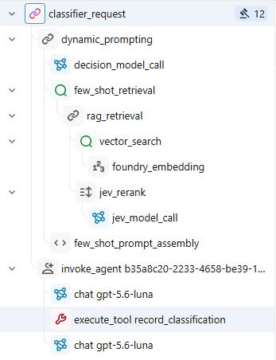

# COSC 650: Applied LLM Systems

An eight-week progression from tokenization fundamentals to an evaluated, observable LLM agent. The repository documents not only what was built, but also the experiments, failures, tradeoffs, and design decisions that shaped the final system.

## Capstone Snapshot

The capstone is a Microsoft Agent Framework application that classifies supplemental patient feedback into HCAHPS-aligned themes. It combines version-controlled prompts, schema-validated tools, dynamic few-shot retrieval, JEV reranking, and MLflow evaluation in one traceable workflow.

| Held-out evaluation result | Score |
| --- | ---: |
| Theme label exact match | 100% (20/20) |
| Confidence exact match | 95% (19/20) |
| Expected label retrieved in top 3 | 100% |
| Tool-call correctness and efficiency | 100% |
| Retrieval groundedness | 55% |

The lower groundedness score is an important result rather than a hidden blemish. Failure analysis showed that relevant examples did not always support every detail of the generated rationale or confidence level.

**Start here:** [Capstone overview](week-8/README.md) | [Executed notebook](week-8/capstone_llm_system.ipynb) | [Evaluation findings](week-8/findings.md)

## Example Classification Trace



## Techniques and Decisions

| Technique | Why it was chosen |
| --- | --- |
| Version-controlled prompts | Keeps instructions, model configuration, and classifier behavior reviewable and reproducible. |
| Pydantic-validated tools | Lets the model interpret language while deterministic code validates state changes and calculates reports. |
| PostgreSQL with pgvector | Provides inspectable vector storage and supports the local retrieval experiments developed in Weeks 5-7. |
| Dynamic few-shot retrieval | Supplies task-relevant labeled examples without placing the entire dataset in every prompt. |
| Decision-1 classification gate | Runs retrieval only for classification requests, avoiding unnecessary work for summaries and plots. |
| JEV reranking | Rescores semantically similar candidates for task relevance before prompt assembly. |
| MLflow tracing and evaluation | Connects aggregate metrics to the exact retrieval, model response, tool arguments, and judge rationale for each case. |

## Eight-Week Progression

Each week adds an engineering capability that becomes part of the final system. The linked findings record measured results, a failure case, and the resulting design lesson.

| Week | Capability and outcome | Evidence |
| --- | --- | --- |
| 1 | Compared tokenizers and quantified tokenization bias, cost, and context effects. | [Findings](week-1/findings.md) |
| 2 | Measured how temperature, top-k, and top-p interact instead of treating sampling controls independently. | [Findings](week-2/findings.md) |
| 3 | Treated prompts as version-controlled artifacts and improved classifier label accuracy from 90% to 100%. | [Findings](week-3/findings.md) |
| 4 | Added schema-validated tools and studied multi-tool ordering and error handling. | [Findings](week-4/findings.md) |
| 5 | Built and evaluated a pgvector RAG pipeline across chunking and embedding strategies. | [Findings](week-5/findings.md) |
| 6 | Added query transformation, reciprocal rank fusion, and JEV reranking while measuring quality-latency tradeoffs. | [Findings](week-6/findings.md) |
| 7 | Compared zero-shot and dynamic few-shot adaptation, then chose source-grounded RAG over premature fine-tuning. | [Findings](week-7/findings.md) |
| 8 | Integrated prompting, tools, retrieval, reranking, tracing, deterministic metrics, and LLM judges into the capstone. | [Findings](week-8/findings.md) |

## Repository Guide

```text
.github/                Version-controlled agent instructions, prompts, and workflow skills
docker/                 Local MLflow and PostgreSQL/pgvector services
notes/                  Reading notes and weekly research-workflow drafts
week-1/ ... week-7/     Progressive experiments, notebooks, and findings
week-8/                 Capstone application, evaluation, documentation, and traces
AGENTS.md               Project conventions and course AI-use disclosures
```

The [context infrastructure guide](.github/CONTEXT_INFRASTRUCTURE.md) explains how repository instructions, path-specific notebook guidance, reusable prompts, and agent skills make AI-assisted work visible and reviewable.

## Stack

Python 3.14+, local Jupyter, UV, Microsoft Agent Framework, Microsoft Foundry, OpenAI and Azure OpenAI models, PostgreSQL with pgvector, Pydantic, MLflow, `text-embedding-3-small`, `all-MiniLM-L6-v2`, RRF, and JEV reranking.

## Scope and Reproducibility

The capstone organizes synthetic supplemental patient comments into **HCAHPS-aligned feedback themes**. It does not administer the official HCAHPS survey or calculate CMS HCAHPS scores. Detailed scope boundaries and official sources are documented in the [capstone README](week-8/README.md).

Experiments run in local Jupyter notebooks with dependencies managed by UV. Secrets stay in the local `.env` file. Weekly findings preserve configurations, measurements, limitations, and failure analyses alongside the executable work.

## Author

Brett - M.S. Artificial Intelligence candidate, Maryville University (December 2026)