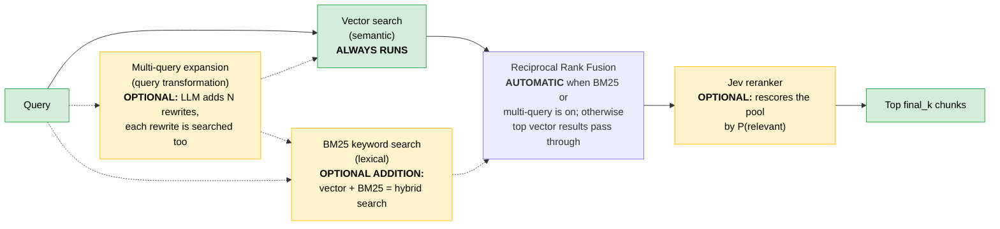

# local_rag

Reusable retrieval pipeline extracted from the [Week 6 notebook](../../week-6/week6_advanced_rag.ipynb) so later notebooks (for example [week7_adaptation.ipynb](../week7_adaptation.ipynb)) can import it instead of redefining it.

Documents are chunked, embedded, and stored in PostgreSQL with pgvector. At query time:

- **Always:** vector search (semantic) runs on every query.
- **Optional:** BM25 keyword search (lexical) runs alongside vector search, which makes the retrieval hybrid (`hybrid_search=True`).
- **Optional:** LLM multi-query expansion (query transformation) searches several rewrites of the query (`multiple_query=True`).
- **Automatic:** Reciprocal Rank Fusion (RRF) merges the ranked lists whenever BM25 or multi-query is on. With neither, the top vector results are used directly.
- **Optional:** a Jev reranker rescores the final pool (`jev_rerank=True`).



Solid arrows always happen. Dotted arrows only happen when the matching option is on. Green boxes always run, yellow boxes are optional, and RRF runs automatically whenever BM25 or multi-query is on.

## Entry point

| File | Purpose |
| --- | --- |
| [retrievers.py](retrievers.py) | `retrieve()` runs the full pipeline for one or more embedders and returns `{embedder_name: [chunk dicts]}`. Flags: `hybrid_search` (adds BM25), `multiple_query` + `additional_query_count` (query expansion), `jev_rerank`. Sizes: `retrieval_k` per query, `pool_k` after fusion, `final_k` returned. |


## Components ([rag_components/](rag_components/))

### Ingestion

| File | Purpose |
| --- | --- |
| [chunkers.py](rag_components/chunkers.py) | The `Chunk` dataclass and four strategies: `chunk_whole`, `chunk_fixed` (character windows), `chunk_markdown_header`, and `chunk_markdown_header_recursive`. Registered in `CHUNKERS`. |
| [embedders.py](rag_components/embedders.py) | The `Embedder` dataclass and two registered embedders: local `all-MiniLM-L6-v2` and hosted `text-embedding-3-small` (Azure AI Foundry). Also maps each embedder to its pgvector table. |
| [database.py](rag_components/database.py) | Handles everything the PostgreSQL database stores: opens the connection, creates the tables, saves chunks and their embeddings, and clears them. It keeps one `doc_chunk` table with the chunk text and metadata, plus one vector table for each embedder. Each chunk gets a stable `chunk_uid`, so saving the same chunk again updates it instead of duplicating it. |
| [clients.py](rag_components/clients.py) | Azure OpenAI client for Foundry using `DefaultAzureCredential`. Reads `FOUNDRY_PROJECT_ENDPOINT` from `.env`. |

### Retrieval

| File | Purpose |
| --- | --- |
| [vector_search.py](rag_components/vector_search.py) | `search_vectors()` ranks chunks by cosine distance in pgvector and returns candidates with `retriever="vector"`. |
| [bm25_search.py](rag_components/bm25_search.py) | `search_bm25()` ranks chunks with Okapi BM25 ([rank_bm25](https://github.com/dorianbrown/rank_bm25)). The tokenizer keeps identifiers (`snake_case`, `camelCase`, dotted names) and weights headings double. Indexes are cached per chunker selection. |
| [query_tranformations.py](rag_components/query_tranformations.py) | `generate_multiple_queries()` asks the LLM for N diverse rewrites using the versioned [multiple-query-generator prompt](../prompts/multiple-query-generator/v1.txt), then strips preambles and list markers. |
| [rerankers.py](rag_components/rerankers.py) | `reciprocal_rank_fusion()` merges ranked lists across retrievers and queries. `rerank_with_jev()` rescores up to 30 candidates with Jev. |

## Attribution

The multi-query, RRF, and Jev reranker pieces are adapted from the work of others.

| Component | Source | License |
| --- | --- | --- |
| Multi-query generation ([query_tranformations.py](rag_components/query_tranformations.py)), RRF ([rerankers.py](rag_components/rerankers.py)) | [RAG-Fusion](https://github.com/Raudaschl/rag-fusion) by Adrian Raudaschl, based on [main.py](https://github.com/Raudaschl/rag-fusion/blob/master/main.py). The preamble filtering follows the `parse_queries()` fix described in the [Jev experiment write-up](https://github.com/Raudaschl/rag-fusion/tree/master/experiments/jev-in-the-pipeline). | MIT |
| Jev reranker ([rerankers.py](rag_components/rerankers.py)) | [RAG-Fusion: Jev experiment](https://github.com/Raudaschl/rag-fusion/tree/master/experiments/jev-in-the-pipeline) by Adrian Raudaschl ([video](https://www.youtube.com/watch?v=SzfGTXWZf4o)), which builds on the [hev reranker](https://github.com/hev/reranker) by Adam Hevenor. | MIT / Apache-2.0 |
| Jev model and SDK | [TypeSafe](https://docs.typesafe.ai/): [System One](https://docs.typesafe.ai/concepts/system-one) and the [Noul primitive](https://docs.typesafe.ai/primitives/noul). | n/a |

The Jev approach asks one yes/no Noul question per retrieved chunk ("is this chunk relevant to the query?"), sends all of them in a single call, and uses the returned probability, P(relevant), as the rank score. My changes: candidates carry retriever metadata through RRF, Jev ties break on rrf_score, the client is created lazily, and multi-query generation goes to a Foundry-hosted model through a versioned prompt.

The original development and attribution notes are in [week6_advanced_rag.ipynb](../../week-6/week6_advanced_rag.ipynb).

## Requirements

- A running pgvector database (see [docker/pgvector](../../docker/pgvector/README.md)). This package does not start the container. Start it yourself with Docker Desktop, or from the repository root with the `-f` (file) flag:

  ```powershell
  docker compose --env-file docker/pgvector/docker.env -f docker/pgvector/docker-compose.yml up -d
  ```
- `.env` values `FOUNDRY_PROJECT_ENDPOINT` and `PGVECTOR_URL`, plus a TypeSafe API key (`TYPESAFE_API_KEY`) when `jev_rerank=True`.
- Dependencies from [pyproject.toml](../../pyproject.toml) (`uv sync`).
